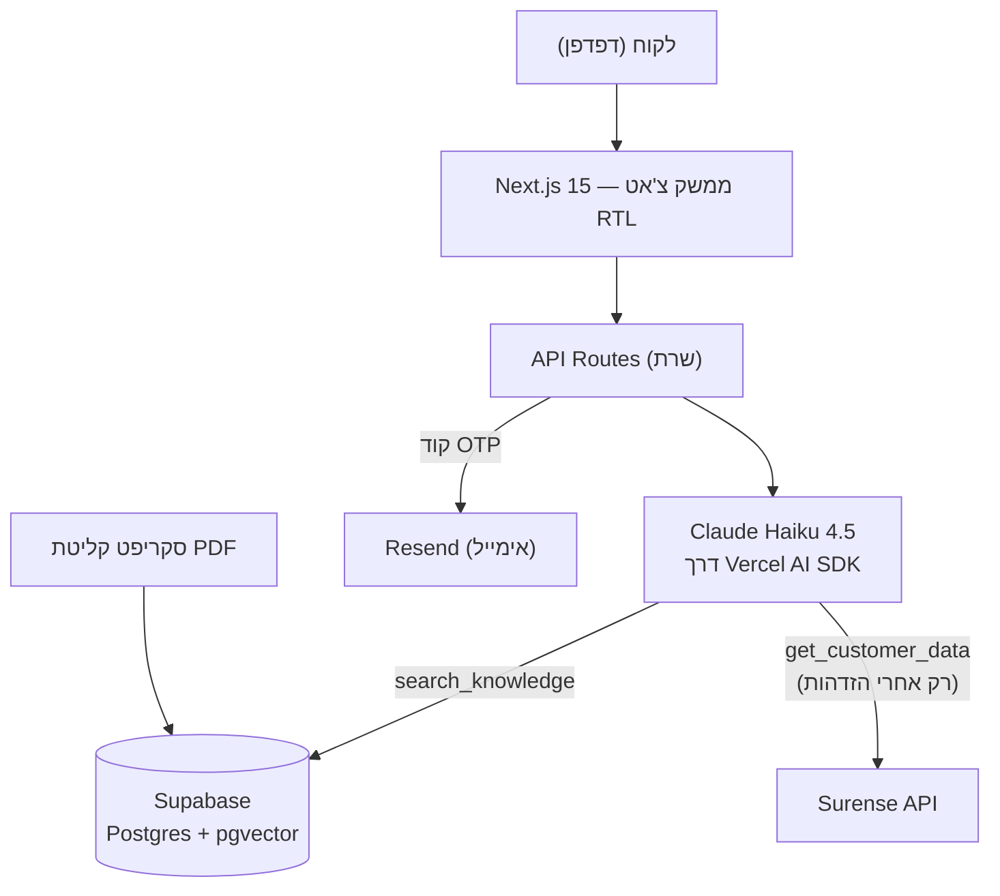
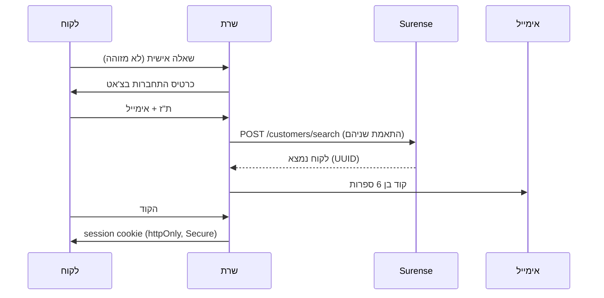

# מסמך אפיון — צ'אט AI ללקוחות סוכנות ביטוח

**גרסה:** 1.0 · **תאריך:** 15.07.2026 · **סטטוס:** לאישור

---

## 1. רקע ומטרות

סוכנות הביטוח מפעילה את מערכת **Surense** לניהול לקוחות. המטרה: צ'אט מבוסס AI בעברית
שמאפשר ללקוחות הסוכנות:

1. **לשאול שאלות כלליות על ביטוח** — ללא התחברות, עם תשובות המבוססות על ~40 מסמכי PDF
   של ידע ביטוחי שהסוכנות מספקת.
2. **לשאול על הפרטים האישיים שלהם** (פוליסות, כיסויים) — רק לאחר הזדהות מאובטחת
   בתוך הצ'אט (ת"ז + אימייל + קוד חד-פעמי למייל), עם שליפה חיה מ-Surense API.

**עקרון מנחה לטון:** הסבר מושגי ביטוח בפשטות — ברור גם לבן/בת 15, תמציתי, בעברית.

### יעדים מדידים
| יעד | ערך |
|---|---|
| משתמשים | ~100 לקוחות, ~50 פעילים |
| תקציב חודשי כולל | ≤ $50 (בפועל ~$48–53 כולל תוסף Surense API; שלב 1 בלבד: ~$11–16) |
| שפה | עברית בלבד, ממשק RTL |
| עדכון מאגר ידע | כל ~חודשיים (40 PDF) |

---

## 2. משתמשים וסיפורי משתמש

| # | בתור... | אני רוצה... | כדי ש... |
|---|---|---|---|
| US-1 | לקוח אנונימי | לשאול "מה זה השתתפות עצמית?" בלי להירשם | אקבל תשובה מיידית ופשוטה |
| US-2 | לקוח אנונימי | לשאול "מה הכיסוי שלי?" | המערכת תסביר שנדרשת הזדהות ותציג טופס התחברות בתוך הצ'אט |
| US-3 | לקוח מזוהה | לשאול על הפוליסות שלי | אקבל תשובה מבוססת על הנתונים האמיתיים שלי מ-Surense |
| US-4 | לקוח | לדעת איך לפנות לבן־אדם | אקבל את פרטי הסוכנת רחלי (מייל) כשהבוט לא עוזר |
| US-5 | הסוכן | לרענן את מסמכי הידע | הצ'אט יענה לפי הגרסאות העדכניות (שלב 2: מסך העלאה) |

---

## 3. דרישות פונקציונליות

- **FR-1** צ'אט זורם (streaming) בעברית, RTL, בעיצוב נקי ומודרני.
- **FR-2** שיחה אנונימית זמינה מיידית; שאלות כלליות נענות מ-RAG על מסמכי הידע.
- **FR-3** שאלה אישית ממשתמש לא מזוהה → הסבר + כרטיס התחברות **בתוך הצ'אט**.
- **FR-4** הזדהות: ת"ז + אימייל → אימות מול Surense → קוד בן 6 ספרות למייל → session.
- **FR-5** לאחר הזדהות: תשובות אישיות משליפה חיה מ-Surense (ללא שמירת נתונים אישיים).
- **FR-6** כל תשובה מבוססת-מסמכים כוללת ציון מקור (שם מסמך + עמוד).
- **FR-7** הפניה לסוכנת אנושית = **הודעה בלבד**: "אפשר לפנות לסוכנת רחלי במייל \<כתובת\>".
  אין ערוץ צ'אט אנושי חי. כתובת המייל מוגדרת בקונפיגורציה (`AGENT_EMAIL` — להשלמה).
- **FR-8** תמיכה בניתוק יזום (logout) ופקיעת session אוטומטית.
- **FR-9** סקריפט קליטת PDF שניתן להרצה חוזרת בכל רענון תוכן.
- **FR-10** כל עוד המשתמש לא מזוהה — **כפתור "התחברות" בראש הצ'אט** עם כיתוב מתאים
  (למשל: "התחברו כדי לשאול על הביטוחים שלכם"). לחיצה פותחת את כרטיס ההתחברות בשיחה.
  אחרי הזדהות הכפתור מוחלף בתג "מחובר/ת" + אפשרות ניתוק.

---

## 4. ארכיטקטורה

- כל הלוגיקה הרגישה (מפתחות, קריאות Surense, רישום כלים למודל) — **בצד שרת בלבד**.
- הדפדפן מקבל רק את זרם התשובה ואת רכיבי ה-UI.

---

## 5. סטאק טכנולוגי ורציונל

| שכבה | בחירה | רציונל |
|---|---|---|
| Framework | **Next.js 15** (App Router) + TypeScript | קוד אחד ל-UI ול-API; אריזה קלה כ-widget בהמשך |
| UI | **Tailwind CSS v4 + shadcn/ui** | עיצוב מודרני, תמיכת RTL מלאה |
| Chat runtime | **Vercel AI SDK v5** | Streaming + Generative UI (כרטיס התחברות בתוך הצ'אט) |
| מודל שפה | **Claude Haiku 4.5** (`claude-haiku-4-5`) | $1/$5 למיליון טוקנים; עברית חזקה; ~$5–10 לחודש בהיקף הזה |
| מסד + וקטורים | **Supabase** (חינם): Postgres + pgvector | DB, חיפוש וקטורי ואחסון בשירות חינמי אחד |
| Embeddings | **Voyage `voyage-3.5-lite`** | רב-לשוני (עברית), זול מאוד ב-40 מסמכים |
| אימייל OTP | **Resend** (חינם עד 3,000 מיילים/חודש) | API מודרני, מכסה בשפע ל-100 לקוחות |
| אחסון/פריסה | **Railway** (~$5/חודש) | שרת Node מלא — streaming ללא מגבלות זמן; deploy אוטומטי מ-GitHub; שימוש מסחרי מותר; region אירופה (קרוב לישראל) |
| Surense | מודול `SurenseClient` מעל ה-REST API | ממשק דק לצורך בדיקות (testability) |

> שדרוג איכות אופציונלי: מעבר ל-Claude Sonnet לשאלות מורכבות — שינוי קונפיגורציה בלבד (ראו 5.1).

### 5.1 הפשטת ספק AI (Provider Abstraction)

- כל קריאות המודל עוברות דרך ממשק הספקים של **Vercel AI SDK** — הקוד לעולם לא מייבא
  SDK של ספק ישירות.
- בחירת מודל בקונפיגורציה: `CHAT_MODEL=anthropic/claude-haiku-4-5` — החלפה ל-Sonnet או
  לספק אחר היא שינוי env, לא שינוי קוד.
- אותו עיקרון ל-embeddings: ממשק `Embedder` עם מימוש Voyage (החלפת ספק מחייבת
  אינדוקס מחדש של 40 המסמכים — פעולה של דקות).
- גבול מודול אחד `ai/`: המודל, ה-embedder וה-system prompt חיים שם; שאר האפליקציה
  תלויה רק בממשק.

---

## 6. אבטחה

### 6.1 תהליך הזדהות

- **מניעת enumeration:** תשובת שגיאה אחידה ("אם הפרטים נכונים — נשלח קוד") בין אם
  הלקוח קיים ובין אם לא.
- **קוד OTP:** 6 ספרות, תוקף 10 דקות, עד 5 ניסיונות, השהיית שליחה חוזרת (60 שניות).
- **Session:** cookie מסוג httpOnly + Secure + SameSite, מכיל את ה-UUID של הלקוח
  ב-Surense; פקיעה אחרי 30 דקות חוסר פעילות.

### 6.2 בידוד נתונים והגנות

- הכלי `get_customer_data` **לא מקבל פרמטר של מזהה לקוח** — השרת מזריק את ה-UUID
  מה-session המאומת. המודל פיזית לא יכול לבקש נתונים של לקוח אחר.
- הכלי נרשם למודל **רק** כשה-session מאומת (רישום צד-שרת לפי מצב ההזדהות).
- **אין נתונים אישיים במנוחה:** שליפה חיה מ-Surense בכל בקשה; לא נשמרים ולא נכתבים ללוגים.
- Rate limiting על מסלולי ה-OTP, HTTPS בלבד, CSP, ולוג ביקורת (audit) של אירועי התחברות.
- טוקני OAuth של Surense נשמרים בצד שרת בלבד (מוצפנים ב-Supabase), לעולם לא בדפדפן.

---

## 7. Guardrails

| הגנה | מימוש |
|---|---|
| תשובות מעוגנות בלבד | עובדות על פוליסות/כיסויים — אך ורק מתוך קטעי המסמכים שאוחזרו או מנתוני Surense. אין מידע רלוונטי → "אני לא יודע/ת — אפשר לפנות לסוכנת רחלי במייל" |
| גבולות נושא | ביטוח בלבד; סירוב מנומס לשאלות משפטיות, רפואיות, השקעות ונושאים לא קשורים |
| הסתייגות (disclaimer) | כל תשובה על כיסוי אישי מציינת שהמידע המחייב הוא במסמכי הפוליסה/אצל הסוכן |
| הגנת prompt-injection | קטעי PDF ונתוני Surense מסומנים כ"נתונים" ולא כהוראות (תיחום בפרומפט); כלי הנתונים האישיים ללא פרמטר מזהה |
| נתיב מילוט אנושי | כשהבוט לא עוזר / שאלה מחוץ לתחום — הודעה: "אפשר לפנות לסוכנת רחלי במייל" (כתובת מהקונפיגורציה) |
| מניעת שימוש לרעה | הגבלת קצב הודעות לכל session + אורך הודעה מקסימלי בנקודת הקצה של הצ'אט |

---

## 8. זיכרון שיחה

- **שלבים 1–2 — זיכרון בתוך ה-session בלבד:** ההיסטוריה נשלחת למודל בחלון הזזה;
  מעל ~20 הודעות — סיכום אוטומטי של ההודעות הישנות לשליטה בעלות טוקנים.
  שום דבר לא נשמר במסד.
- **שלב 3 — היסטוריה מתמשכת:** שמירת שיחות ב-Supabase; משתמש מזוהה רואה שיחות
  קודמות; היסטוריה אנונימית נמחקת אחרי 30 יום.
- **היגיינת מידע אישי:** הודעות המכילות נתונים אישיים מ-Surense מסומנות
  ו**אינן נשמרות לעולם** (נשארות רק בזיכרון ה-session החי) — שמירה על עקרון
  "אין נתונים אישיים במנוחה".

---

## 9. צינור RAG (קליטת מסמכים)

סקריפט קליטה: פענוח 40 ה-PDF → חלוקה לקטעים (~500 טוקנים עם חפיפה) → embedding →
טעינה ל-pgvector. מורץ מחדש בכל רענון תוכן (~חודשיים).

> ⚠️ חילוץ טקסט עברי מ-PDF רגיש לבעיות סדר-תווים (RTL). שלב הקליטה כולל בדיקת שפיות
> אוטומטית (זיהוי טקסט הפוך/מקוטע) ודגימה ידנית של מסמך לפני טעינה.

### 9.1 Metadata לכל קטע

| שדה | שימוש |
|---|---|
| שם קובץ + כותרת מסמך | ציטוט מקור בתשובות |
| מספר עמוד + כותרת סעיף | ציטוט מדויק + בדיקת נאמנות (faithfulness) בהערכה |
| תחום ביטוח (רכב / דירה / בריאות / חיים...) | סינון אחזור כשנושא השיחה ידוע |
| גרסת מסמך + תאריך קליטה | רענון: החלפת PDF מוחקת ומטעינה רק את הקטעים של אותו מסמך |
| שפה | הרחבה עתידית |

---

## 10. הערכת RAG (Evaluation)

- **Golden set:** ~40–50 זוגות שאלה-תשובה בעברית שנכתבים עם הסוכן (1–2 לכל מסמך),
  כולל שאלות-מלכודת שהתשובה הנכונה להן היא "אין לי מידע על זה".
- **הערכה דו-שכבתית (סקריפט TypeScript בריפו, ללא שירות בתשלום):**
  1. *אחזור:* recall@k — האם הקטע הנכון מופיע ב-top-k?
  2. *תשובות:* LLM-כשופט — Claude Sonnet מדרג נאמנות להקשר ונכונות מול תשובת הזהב
     (Sonnet רק בהרצות הערכה — עלות זניחה).
- **מתי רצים:** אחרי כל רענון PDF ואחרי כל שינוי ב-chunking / embeddings / פרומפט / מודל.
- **ספי מעבר:** recall@5 ≥ 90% · נאמנות ≥ 95% · אפס תשובות מומצאות בשאלות המלכודת.
- אופציה עתידית: Promptfoo כ-runner עם ממשק תוצאות.

---

## 11. אינטגרציית Surense

מקור: https://developer.surense.com/ · Base URL: `https://api.surense.com/api/v1`

- **אימות:** OAuth 2.0 Authorization Code (`auth.surense.com/authorize` + `/oauth/token`),
  scope `customers:read`. **הסוכן מאשר את האפליקציה פעם אחת**; השרת שומר ומרענן טוקנים
  (מוצפנים ב-Supabase, לעולם לא בדפדפן).
- **אימות זהות לקוח:** `POST /customers/search` עם פילטרים
  (`filtersOperator: "and"`, שוויון על `idNumber` + `email1`). התאמה על שניהם = תנאי
  לשליחת קוד OTP. באובייקט הלקוח: `idType` (1 = ת"ז), `idNumber`, `email1`/`email2`.
- **שליפת פרטי לקוח:** `GET /customers/{id}` לפי UUID שנקלט בהתחברות ונשמר ב-session
  (60+ שדות: שמות, טלפונים, כתובת, תעסוקה ועוד).
- **נתוני פוליסות — מקטע Products:** `GET /products/types` + `POST /products/search` —
  ככל הנראה המוצרים הביטוחיים בתיק הלקוח (scope: `global:user`). סכמת התשובה ואופן
  הסינון לפי לקוח אינם מתועדים; יש endpoint גילוי `GET /{entity}/fields` — **נוודא
  בקריאת ניסיון ברגע שיש הרשאות**, ללא תלות בתשובה אנושית מ-Surense.
- **Customer Reports** (`/customers/{id}/reports/*`): מנגנון הפקה/שליחה של דוחות PDF
  ללקוח לפי providerId (scope: `customers:update`). לא מקור הנתונים לצ'אט — רלוונטי
  אולי לשלב 3 (שליחת דוח ללקוח מהצ'אט).
- **Scopes נדרשים (מצטבר):** `customers:read` + `global:user` (products); לוודא בהרשמה.
- **עלות והפעלה:** גישת ה-API היא תוסף בתשלום בחשבון הסוכנות — **120 ₪ + מע"מ לחודש**
  (≈ $37). ההפעלה בשירות עצמי מתוך החשבון (קטגוריית API). נדרש רק משלב 2.
  נותר לוודא: איפה מקבלים את מפתחות ה-OAuth אחרי ההפעלה.

### 11.1 שאלות פתוחות ל-Surense (לשלוח כמו שהן)

1. האם קיימת סביבת Sandbox לבדיקות, ומהן מגבלות הקצב (rate limits)?
2. איך נרשמים כאפליקציית OAuth, ומה ה-grant המומלץ לשרת-אל-שרת
   (refresh token ארוך-חיים או client credentials)?

**נענו מהתיעוד (15.07.2026):** שמות שדות זהות (`idNumber`, `email1`) ✓ ·
מיקום משוער של נתוני הפוליסות (Products) ✓ — נותר אימות טכני בקריאת ניסיון.

---

## 12. אפיון UI/UX

- **מבנה:** מסך צ'אט אחד, נקי ומודרני; בועות הודעה, אינדיקטור הקלדה, streaming של תשובות.
- **RTL מלא:** `dir="rtl"`, `lang="he"`, טיפוגרפיה עברית נעימה.
- **כפתור התחברות בכותרת (FR-10):** כל עוד המשתמש לא מזוהה מוצג בראש הצ'אט כפתור
  "התחברות" עם כיתוב מזמין ("התחברו כדי לשאול על הביטוחים שלכם"); לחיצה פותחת את
  כרטיס ההתחברות בשיחה. אחרי הזדהות — תג "מחובר/ת" + ניתוק.
- **התחברות בתוך הצ'אט:** כרטיס inline (ת"ז + אימייל → שדה קוד) שמופיע כהודעת מערכת
  בשיחה (נפתח מהכפתור בכותרת או אוטומטית בשאלה אישית); אחרי הצלחה — המשך שיחה טבעי.
- **מצבי שיחה:** אנונימי (שאלות כלליות) ⟷ מזוהה (הכול). מעבר חלק ללא איבוד הקשר.
- **ציטוטי מקור:** תחת תשובה מבוססת-מסמכים — שם המסמך והעמוד (ניתן להרחבה).
- **פנייה לסוכנת:** כשהבוט לא עוזר — הודעה בצ'אט: "אפשר לפנות לסוכנת רחלי במייל
  \<כתובת\>" (הכתובת מקונפיגורציה; להשלמה). אין ערוץ אנושי חי.
- **נגישות:** ניווט מקלדת, ניגודיות תקינה, תמיכת קורא מסך בהודעות נכנסות.
- **שלב 3:** אריזה כ-widget להטמעה באתר הסוכנות (bubble בפינת המסך).

---

## 13. הערכת עלויות חודשית

| רכיב | עלות | נדרש משלב |
|---|---|---|
| Railway (אחסון) | ~$5 | 1 |
| Supabase (free tier) | $0 | 1 |
| Resend (free tier) | $0 | 2 |
| Voyage embeddings (40 PDF + שאילתות) | ‎<$1 | 1 |
| Claude Haiku 4.5 (~500 הודעות משתמש/חודש) | ~$5–10 | 1 |
| **תוסף Surense API/Webhooks** (120 ₪ + מע"מ ≈ 140 ₪) | ~$37 | **2** |
| **סה"כ שלב 1 (MVP)** | **~$11–16** | |
| **סה"כ מלא (משלב 2)** | **~$48–53** ⚠️ סביב התקרה | |

- הערכת המודל: ‎~50 משתמשים פעילים × ~10 הודעות/חודש, ~2 קריאות מודל להודעה (כלי + תשובה).
  Prompt caching על ה-system prompt מוריד את העלות עוד.
- תוסף ה-Surense נספר כחלק מעלות הצ'אט (החלטה: 15.07.2026). הוא נדרש רק משלב 2 —
  שלב 1 רץ בלעדיו.
- התרחיש המלא גבולי מול תקרת ה-$50: בחודשים שקטים ~$48, בחודשים עמוסים עד ~$53.
  כרית ביטחון אפשרית: הקטנת השימוש במודל (caching אגרסיבי יותר) — לא נדרש שינוי ארכיטקטורה.

---

## 14. מפת דרכים

| שלב | תכולה |
|---|---|
| **שלב 1 — MVP** | צ'אט כללי בעברית + RAG עם metadata + guardrails + golden set להערכת RAG + סקריפט קליטת PDF |
| **שלב 2 — אזור אישי** | התחברות מול Surense + OTP למייל + שאלות אישיות + מסך העלאת PDF לסוכן |
| **שלב 3 — הרחבות** | היסטוריית שיחות מתמשכת + widget להטמעה + זיכרון העדפות (אופציונלי) + הקשחות לפי תשובות Surense לשאלות הפתוחות |

---

## 15. סיכונים ותלויות

| סיכון/תלות | חומרה | טיפול |
|---|---|---|
| סכמת Products (פוליסות) לא מתועדת | בינונית | אימות עצמי בקריאת ניסיון (`GET /products/fields` + search) ברגע שיש הרשאות; לא חוסם את שלב 1 |
| אין Sandbox מתועד ב-Surense | בינונית | שאלה פתוחה 11.1; עד אז — בדיקות מול לקוח-דמה אמיתי בחשבון הסוכן |
| חילוץ טקסט עברי מ-PDF | בינונית | בדיקת שפיות בקליטה + דגימה ידנית (סעיף 9) |
| איכות תשובות במודל זול | נמוכה | הערכת RAG שוטפת; מסלול שדרוג ל-Sonnet בשינוי קונפיג |
